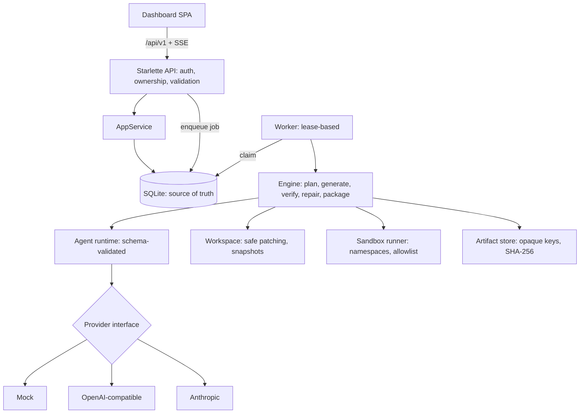

# System overview

## Run lifecycle
`DRAFT → PLANNING → AWAITING_PLAN_APPROVAL → GENERATING → VERIFYING ⇄ REPAIRING (≤ max_repair_attempts) → AWAITING_EXPORT_APPROVAL → PACKAGING → SUCCEEDED`
with `FAILED / CANCELLED / POLICY_BLOCKED` reachable from any active state, and `FAILED → (stage)` via idempotent retry.
Plan change requests loop `AWAITING_PLAN_APPROVAL → PLANNING` and create a new plan version.

## Where things live
| Concern | Module |
|---|---|
| Transitions, events, audit, jobs | `autoforge/core/services.py`, `domain/states.py` |
| Use-cases + authorization | `core/app_service.py` |
| HTTP, auth, CSRF, SSE, headers | `api/app.py` |
| Steps, budgets, retries | `orchestration/engine.py`, `worker.py` |
| Agent schemas / providers | `agents/schemas.py`, `providers/*` |
| Workspace / sandbox / scanner / reports | `workspace/`, `sandbox/`, `verification/` |
| Generated-project template | `templates/python_service.py` |

## Agent roles in this edition
Requirements, architect, planner, implementer/test/packaging (via `file_patch`), reviewer, repair. Tool permissions are
enforced in code: planners have no file access; implementers write only the files their task owns; repair cannot touch tests.
Tasks execute serially in topological order (parallel generation is deliberately not implemented; see implementation plan).
